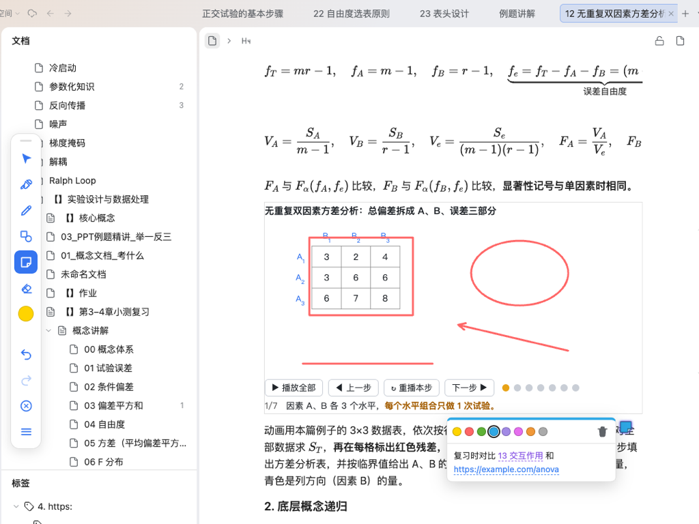

# Zotero Toolbar for SiYuan

Bring Zotero's annotation toolbar to SiYuan: annotate any document with a pen, highlighter, shapes, sticky notes and an eraser on a **separate layer** that never touches your content, including embedded HTML animations and iframes.



## Features

The toolbar mirrors Zotero: a vertical, icon-only strip. The color dot (or tapping the active tool again) opens a popover for color, size and shape kind, export, clear and settings live under ⋯, and ≡ at the bottom is the drag handle. Tools, in order:

| Tool | What it does |
|---|---|
| Pointer | The page works as usual (select text, follow links, click animation buttons); press on a stroke or shape to select, drag, duplicate or delete it |
| Highlighter | Translucent, multiply-blended so text stays readable |
| Pen | Stylus pressure; pause at the end of a stroke to straighten it into a shape (can be turned off) |
| Shapes | Rectangle, ellipse, line, arrow by dragging; hold Shift for squares/circles and 45° lines |
| Sticky note | Click anywhere to pin a note, drag it around, click to read or edit; 8 Zotero colors |
| Eraser | Stroke eraser with adjustable size |

**Links in sticky notes**

- Block refs `((block-id 'title'))`: paste straight from SiYuan's "Copy block ref". Hovering shows SiYuan's own preview (following your float-window setting), and clicking opens the block.
- `siyuan://blocks/…` links, `[label](url)` and bare URLs all become clickable links.
- In annotation mode, dragging a document from the doc tree, or a block (by its gutter icon) from another tab, onto the page pins a note that links to it.

**Layer behaviour**

- Enter annotation mode from the floating pen button, the top-bar button or the command palette; Esc exits.
- Outside annotation mode, strokes and shapes stay visible while input passes through to the document, so animations and buttons keep working. Sticky notes can be opened and dragged in both modes.
- Strokes, shapes and notes are anchored to their block and follow it through reflow, window resizes and animated iframes changing height.
- Undo/redo covers everything (create, move, recolor, edit, delete, clear): `Ctrl/Cmd+Z`, `Ctrl/Cmd+Shift+Z`.

## Storage

One JSON file per document:

```
{workspace}/data/storage/petal/siyuan-zotero-toolbar/{docID}.json
```

This is the plugin's private data directory and it syncs with SiYuan. Concurrent edits on two devices merge strokes and notes by id, and the local copy wins when ids match.

## Install

- **Marketplace**: Settings → Marketplace → Plugins, search "Zotero Toolbar".
- **Manual**: download `package.zip` from [Releases](https://github.com/FlowMorph/siyuan-zotero-toolbar/releases), unzip into `{workspace}/data/plugins/siyuan-zotero-toolbar/`, and enable it under Downloaded.

## Development

```bash
npm install
npm run typecheck
npm test            # unit tests: shape geometry, note text parsing, note undo/merge
npm run build       # → build/
npm run e2e         # deploy to the local workspace and drive SiYuan's web UI with Chrome
npm run pack        # build + package.zip for the marketplace
```

E2E defaults to the `~/SiYuan` workspace, a kernel at `http://127.0.0.1:6806` and Chrome on macOS. Override them with `SIYUAN_WORKSPACE`, `SIYUAN_BASE` and `CHROME_PATH`. For the code map, see [docs/index.md](docs/index.md).

## Credits

Built on [Pencil Annotation](https://github.com/BUGdefender404/pencil-annotation) (MIT). The pen, highlighter, eraser, selection, gestures and sync-safe storage come from that project. This plugin adds shapes, sticky notes, drag-in links and a Zotero-style toolbar.

## License

MIT, with the original project's copyright notice retained.
