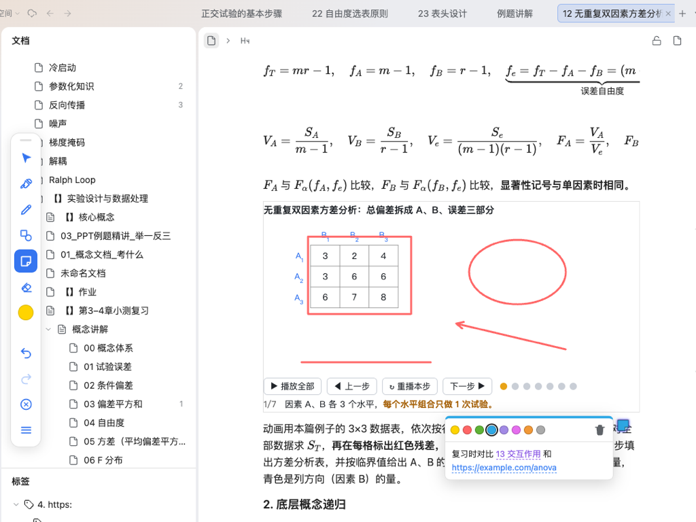

# Zotero 工具栏（思源笔记插件）

把 Zotero 的批注工具栏搬进思源：在文档上方的**独立图层**里用画笔、荧光笔、形状、便笺和橡皮做批注。批注和正文互不干扰：不改动文档内容，也不影响页面里的 HTML 动画、iframe 等交互内容。



## 功能

工具栏复刻 Zotero：竖排、只有图标，点颜色圆点打开二级面板选颜色、粗细和形状，导出、清空、设置在底部菜单里。各工具如下：

| 工具 | 说明 |
|---|---|
| 选择 | 点选笔迹或形状后拖动，可复制、删除 |
| 荧光笔 | 半透明，正片叠底，下面的文字仍然清楚 |
| 画笔 | 支持触控笔压感；画完停顿会自动变成规则图形（可在设置里关闭） |
| 形状 | 矩形、椭圆、直线、箭头，拖拽画出；按住 Shift 画正方形或圆，直线和箭头吸附到 45° |
| 便笺 | 点页面任意位置放一个便笺，可以拖动；点开就能编辑，有 8 种 Zotero 颜色 |
| 橡皮 | 按笔画擦除，大小可调 |

**便笺里的链接**：

- 块引用 `((块ID '标题'))`：可以直接粘贴思源「复制块引用」的结果。悬停时显示思源的预览（遵循你在设置里选的悬浮窗触发方式），点击跳转。
- `siyuan://blocks/…` 链接、`[文字](网址)` 和普通网址，都会显示成可点击的链接。
- 在批注模式下，从文档树把文档拖到页面上，或者从其他页签按住块标拖动一个块过来，会自动生成指向它的便笺。

**图层行为**：

- 点笔形按钮（或顶栏按钮、命令面板）进入批注模式，按 Esc 退出。
- 退出批注模式后，笔迹和形状照常显示，鼠标操作会穿透到正文，所以动画、按钮可以正常点击。便笺在两种模式下都能点开和拖动。
- 笔迹、形状和便笺都锚定在所在的块上：正文重排、窗口宽度变化、动画改变 iframe 高度时，批注会跟着块移动。
- 撤销和重做覆盖所有操作（新建、移动、改色、编辑、删除、清空），桌面端快捷键是 `Ctrl/Cmd+Z` 和 `Ctrl/Cmd+Shift+Z`。

## 数据存储

每篇文档的批注存成一个 JSON 文件：

```
{工作空间}/data/storage/petal/siyuan-zotero-toolbar/{文档ID}.json
```

这个目录属于插件私有数据区，参与思源的同步。两台设备同时修改同一篇文档时，笔迹和便笺按 ID 取并集，ID 相同时本地版本优先。

## 安装

- **集市**：设置 → 集市 → 插件，搜索「Zotero 工具栏」。
- **手动**：从 [Releases](https://github.com/FlowMorph/siyuan-zotero-toolbar/releases) 下载 `package.zip`，解压到 `{工作空间}/data/plugins/siyuan-zotero-toolbar/`，在「已下载」里启用。

## 开发

```bash
npm install
npm run typecheck   # 类型检查
npm test            # 单元测试（形状几何、便笺文本解析、便笺撤销与合并）
npm run build       # 构建到 build/
npm run e2e         # 端到端测试：部署到本机工作空间，用 Chrome 驱动思源网页端验证
npm run pack        # 构建并生成上架用的 package.zip
```

端到端测试默认使用 `~/SiYuan` 工作空间、`http://127.0.0.1:6806` 内核和 macOS 上的 Chrome，可以用环境变量 `SIYUAN_WORKSPACE`、`SIYUAN_BASE`、`CHROME_PATH` 修改。代码结构说明见 [docs/index.md](docs/index.md)。

## 致谢

本插件基于 [Pencil Annotation](https://github.com/BUGdefender404/pencil-annotation)（MIT）开发。画笔、荧光笔、橡皮、选择、手势和同步存储都来自原项目，本项目在此基础上增加了形状、便笺、拖入链接，以及按 Zotero 习惯组织的工具栏。

## 许可

MIT，保留原项目的版权声明。
